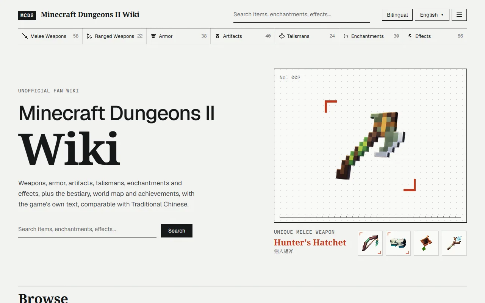
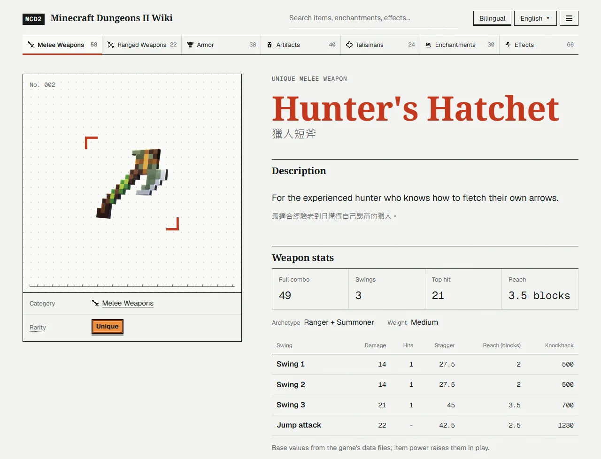
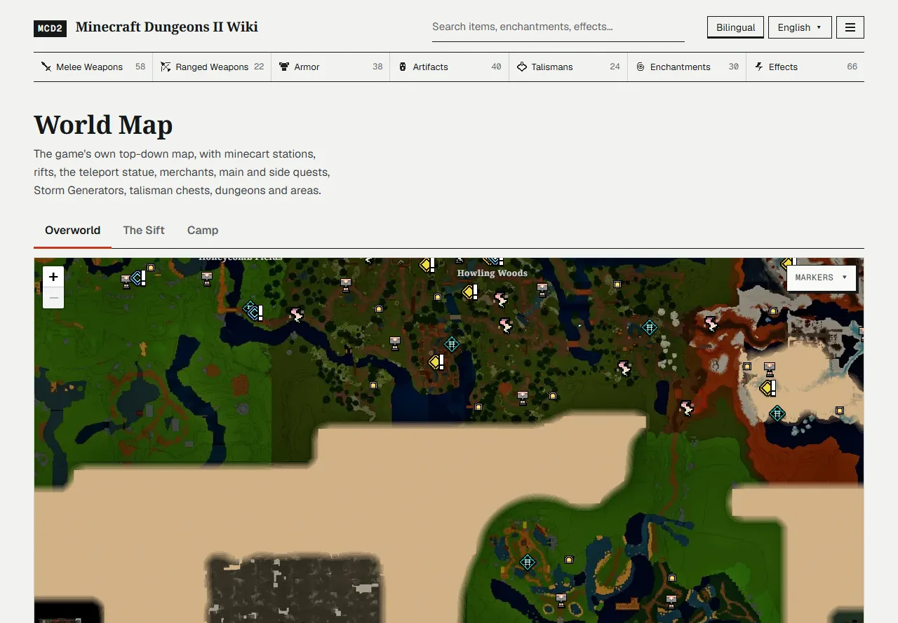
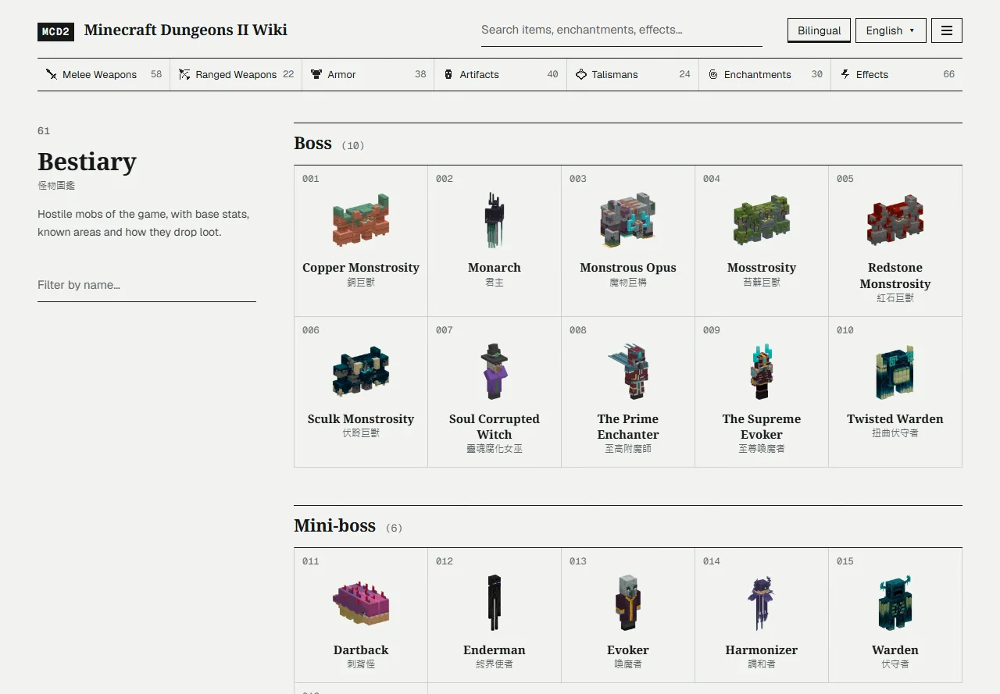

<div align="center">

# Minecraft Dungeons II Wiki

**A fan-made reference built straight from the game's own data, in 16 languages**

Weapons, armor, artifacts, enchantments, the bestiary, the world map, quests, Soul Storms, drop odds and more,<br>
with every number and name taken from the game files rather than typed in by hand.

[](https://mrpippi.github.io/mcd2-wiki/)
[](#good-to-know)
[](#languages)
[](https://github.com/MrPippi/mcd2-wiki/actions/workflows/deploy.yml)
[](LICENSE)

[**Open the wiki**](https://mrpippi.github.io/mcd2-wiki/) · [**FAQ**](#faq) · [**Report a mistake**](https://github.com/MrPippi/mcd2-wiki/issues/new/choose) · [**Discussions**](https://github.com/MrPippi/mcd2-wiki/discussions)

**English** · [繁體中文](README.zh-TW.md)

</div>

---



## Highlights

- **Straight from the game**: names, descriptions and stats are extracted from the game's DataTables and localization. The data matches **game version 1.1.3.0**.
- **16 languages**: game text uses the official translations, so it matches what you see in game.
- **Bilingual mode**: show every name and description in a second language as well.
- **No guessing**: values the data can't explain are left out or marked unconfirmed.
- **Free, no sign-up**: a static site that works on phones too.

## Contents

- [What you can look up](#what-you-can-look-up)
- [Handy features](#handy-features)
- [Languages](#languages)
- [FAQ](#faq)
- [For contributors](#for-contributors)
- [For rights holders](#for-rights-holders)
- [Security](#security)
- [License](#license)

---

## What you can look up

| Section | What's in it |
| --- | --- |
| **Melee and ranged weapons** | Damage, stagger, reach and knockback for every hit of the combo, the weapon's role and weight, every effect it can roll at levels I, II and III, and the odds of each effect by threat level |
| **Armor** | Every set and each of its pieces, with the slot, description, unique variant and effect odds |
| **Artifacts** | Cooldown, soul cost, duration and area, plus the effects they can roll and their odds |
| **Talismans** | The value at each level and the XP needed to reach the next one |
| **Enchantments** | Values at levels I, II and III, and which enchantment books carry them |
| **Effects** | Every effect with its values at each level |
| **Statuses** | Burning, Frozen, Poisoned and the rest: buff or debuff, default duration and modifiers, status fusion, and the artifacts, enchantments, effects and mobs that use them |
| **Bestiary** | A portrait, health, toughness, resistances, soul yield and drops for each mob, including the Soul Corrupted versions, and the areas where they spawn |
| **Soul Enchantments** | The buffs Soul Corrupted mobs can spawn with, their values at each tier, and which mobs or arenas never get them |
| **World map** | The Overworld, the Sift and the Camp, with minecart stations, rifts, the teleport statue, merchants, main and side quests, Storm Generators, talisman chests, dungeons and area names |
| **Soul Storms** | A live countdown to the current and next storm in your time zone, the area rotation with how many Storm Generator spots each area has, Storm Generator difficulty, health and shields, and what the reward chests drop |
| **Build Planner** | Pick your weapons, armor, artifacts and talismans, then share the build as a link (it opens the same build) or download it as an image for social media |
| **Weapon Compare** | Up to three weapons side by side: combo damage, fire rate, reach, stagger, built-in bonus and the effects each can roll, with the best value marked; share it as a link |
| **Drop Calculator** | Pick an item, threat level, difficulty and rarity to see how likely each source (chests, quest rewards, bosses and regular mobs) is to drop it |
| **Guides** | Game mechanics from the game's own data: vendor upgrade costs and unlocks, enchanting costs and upgrades, rarity effects and drop weights, threat levels and difficulty, secret talismans, currency caps and recommended level by story stage; anything the data cannot explain is marked unconfirmed |
| **Quests** | Every core quest in story order, side quests by region, Echo Golem quests and boss replays, each with its objectives, prerequisites, the quests it unlocks, first-completion and repeat rewards, emeralds by quest size, and the mobs you fight. Item pages name the quest a reward comes from |
| **Locations** | One page per region with its area icon and the player level the game sets for it (where the game has them), a link to its spot on the map where the map marks it, the places inside it, the monsters found there by kind, its quests and its area loot. Mob and quest pages link to the region |
| **Bosses** | The 10 bosses and 6 mini-bosses in story order, with health, region, and the core quest and boss replay each one appears in, where the game data names them |
| **Achievements** | All Steam achievements with global unlock rates. Hidden ones stay hidden until you choose to reveal how to unlock them |
| **Changelog** | What each game update changed (grouped into new, changed and fixed, then by topic) with a link to the official notes, the version the site's data comes from, and the changed values whenever the data moves to a new version |

Item pages also list where an item comes from (quest rewards, chests, merchants or enchantment book pools) and the drop odds from each source.



## Handy features

- **Two languages side by side.** Turn on **Bilingual** to show each name and description in a second language as well: Traditional Chinese on the English site, English on every other site. It's useful when a friend plays in another language, or when a guide uses English names.
- **Search everything.** Search by name in your language or in English, from any page.
- **Filter lists.** Type to narrow a category, or show only Normal or Unique items.
- **Share a map view.** The map's address keeps the world, zoom and position, so you can send someone the exact spot. You can also filter the markers or search for a place.
- **Keyboard shortcuts.** Q and E switch to the previous or next item category, and Z and X switch worlds on the map, as in the game.
- **Works on phones.** Every page is laid out for small screens.





## Languages

繁體中文 · 简体中文 · English · 日本語 · 한국어 · Deutsch · Français · Español · Italiano · Português (Brasil) · Русский · Polski · Nederlands · Svenska · Türkçe · Українська

Item names, descriptions and other game text come from the game's own localization, so they match what you see in the game. The site's own wording (menus, labels, notes) is hand-written in Traditional Chinese and English and machine-translated into the other languages. Where a translation was found to be wrong, that line falls back to English.

---

## FAQ

<a id="good-to-know"></a>

**Why don't the numbers match what I see in a run?**

They are base values from the game files. Difficulty, party size and gear power change what you see in a run.

**Why is something missing, like swing timings or damage per second?**

Some things aren't in the game data. Swing timings and damage per second live in animation files, so the wiki doesn't show them. Entries whose numbers can't be worked out from the data are left out rather than guessed.

**Will the wiki follow game updates?**

Yes. When the game updates, the wiki is updated by extracting the new game files again. The version the data matches is shown at the top of this page.

**I found a mistake. How do I report it?**

Open an [issue](https://github.com/MrPippi/mcd2-wiki/issues/new/choose), pick the matching form, and include the page link and what you saw in the game. A screenshot helps. Questions and feature ideas go to [Discussions](https://github.com/MrPippi/mcd2-wiki/discussions).

---

## For contributors

How the data is extracted, how the map tiles are built and how to run the site locally: see [docs/MAINTAINING.md](docs/MAINTAINING.md) (in Traditional Chinese).

```bash
npm install
npm run dev
```

## For rights holders

This is an unofficial fan site. If you hold rights to any of the game text or images shown here and want something removed, [open an issue](https://github.com/MrPippi/mcd2-wiki/issues/new) naming what should be removed, and it will be taken down as soon as possible.

## Security

Please don't disclose security issues in public. Report them privately through GitHub; see [SECURITY.md](SECURITY.md).

## License

- **Source code**: released under the [MIT License](LICENSE).
- **Game text and images**: not covered by the MIT License. This includes everything extracted from the game under `public/` (map tiles, icons, mob renders), `src/data/`, `src/assets/` and `docs/images/`. They belong to their respective owners.
- **Fonts**: Noto Serif, Noto Serif TC/SC/JP/KR, Geist and Geist Mono are licensed under the SIL Open Font License 1.1.

---

<div align="center">

Not an official Minecraft product. Not approved by or associated with Mojang Studios or Microsoft.

</div>
