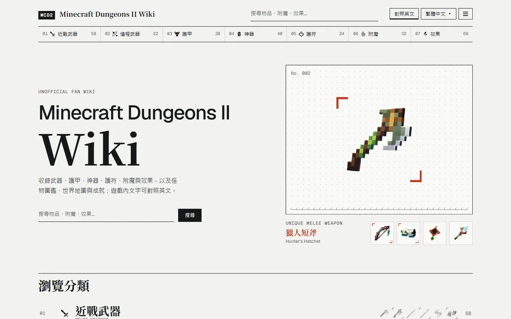
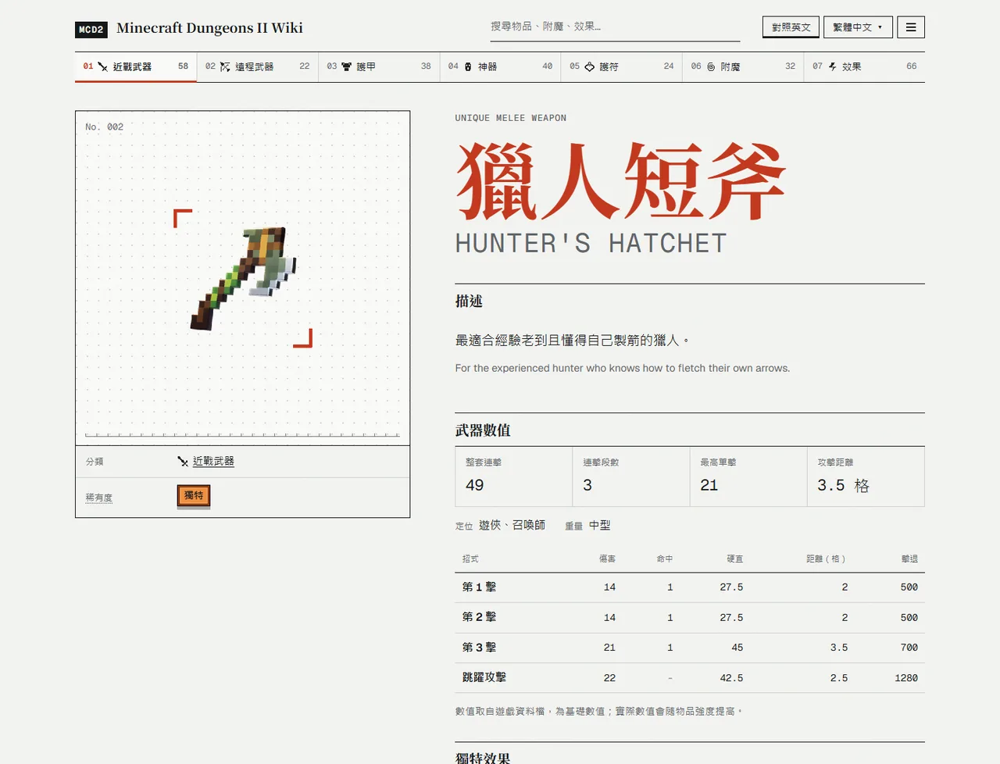
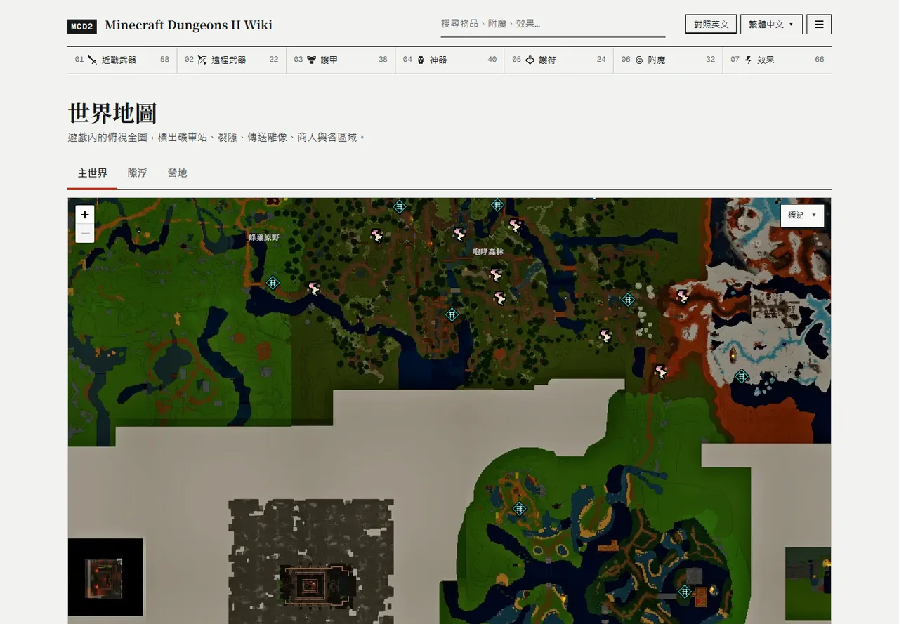
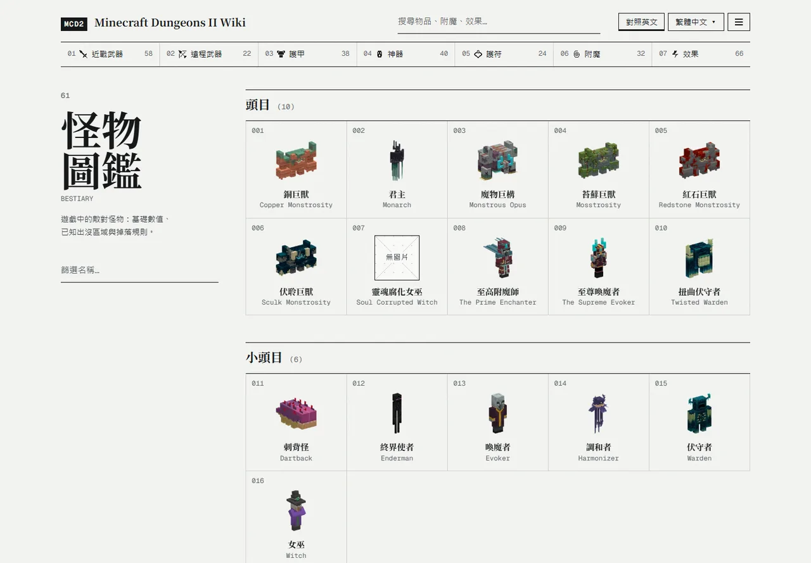

# Minecraft Dungeons II Wiki

[English](README.md) · **繁體中文**

玩家自製的 **Minecraft Dungeons II** 資料站。內容直接取自遊戲本身的資料與文字，提供 16 種語言。

**[進入 Wiki →](https://mrpippi.github.io/mcd2-wiki/zh/)**



## 可以查什麼

| 分類 | 內容 |
| --- | --- |
| **近戰與遠程武器** | 連擊中每一擊的傷害、硬直、距離與擊退，武器的定位與重量，以及可能出現的效果與 I／II／III 級數值 |
| **護甲** | 每一套護甲與各部位，含部位、說明與獨特版本 |
| **神器** | 冷卻時間、靈魂消耗、持續時間與範圍，以及可能出現的效果 |
| **護符** | 每一級的數值，與升到下一級所需的經驗值 |
| **附魔** | I／II／III 級數值，以及哪些附魔書會出現 |
| **效果** | 所有效果與各等級數值 |
| **怪物圖鑑** | 每隻怪物的生命值、韌性、各項抗性、靈魂產量與掉落，含靈魂腐化版本，以及出沒區域 |
| **世界地圖** | 主世界、隙浮與營地，標出礦車站、裂隙、傳送雕像、商人與區域名稱 |
| **靈魂風暴** | 目前與下一場風暴的即時倒數（以你的時區顯示）、區域輪替、風暴產生器的難度、生命值與護盾，以及獎勵寶箱的內容。時刻由遊戲資料推算，在遊戲內確認前會標示為推算值 |
| **配裝** | 選好武器、護甲、神器與護符組成一套配裝，複製連結分享（打開就是同一套），或下載成圖片貼到社群 |
| **成就** | 所有 Steam 成就與全球達成率；隱藏成就要你自己點開才會顯示解鎖條件，不怕被劇透 |

物品頁也會列出取得方式：任務獎勵、寶箱、商人或附魔書池。



## 好用的功能

- **中英對照**：打開右上角的「對照英文」，每個名稱和說明下方會多一行英文（英文版網站則對照繁體中文）。跟用英文玩的朋友溝通、看英文攻略時特別方便。
- **全站搜尋**：在任何頁面都能用中文或英文名稱搜尋。
- **清單篩選**：輸入文字縮小範圍，或只看「一般」、「獨特」物品。
- **分享地圖位置**：地圖網址會記住世界、縮放與位置，直接把網址傳給朋友就能看到同一個地方。標記可以篩選，也能搜尋地點。
- **手機也好用**：每一頁都有針對小螢幕的版面。





## 支援語言

繁體中文 · 简体中文 · English · 日本語 · 한국어 · Deutsch · Français · Español · Italiano · Português (Brasil) · Русский · Polski · Nederlands · Svenska · Türkçe · Українська

物品名稱、說明等遊戲文字都取自遊戲官方的多語系檔，和你在遊戲裡看到的一樣。網站自己的文字（選單、標籤、註解）繁體中文與英文為人工撰寫，其他語言為機器翻譯；確認翻錯的句子會改顯示英文。

## 使用前須知

- **數值是遊戲資料檔裡的基礎值**，實際遊玩時會受難度、隊伍人數與裝備強度影響。
- **有些資料不在遊戲資料表裡**：例如每一擊的出手時間與每秒傷害存在動畫檔中，所以網站不顯示。無法從資料算出數值的條目會先不上架，不用猜的。
- **遊戲改版時**，會重新從新版遊戲檔案抽取資料來更新網站。

## 發現錯誤？

請開一則 [Issue](https://github.com/MrPippi/mcd2-wiki/issues)，附上頁面網址，並說明你在遊戲中看到的內容；有截圖更好。

## 參與開發

資料怎麼抽取、地圖圖塊怎麼產生、如何在本機執行網站，請見 [docs/MAINTAINING.md](docs/MAINTAINING.md)。

```bash
npm install
npm run dev
```

## 免責聲明

本站為非官方粉絲網站，與 Mojang Studios、Microsoft 無關，也未獲其背書。遊戲文字與圖像版權歸原權利人所有。網站使用的字型（Noto Serif、Geist、Geist Mono）採用 SIL Open Font License 1.1 授權。
